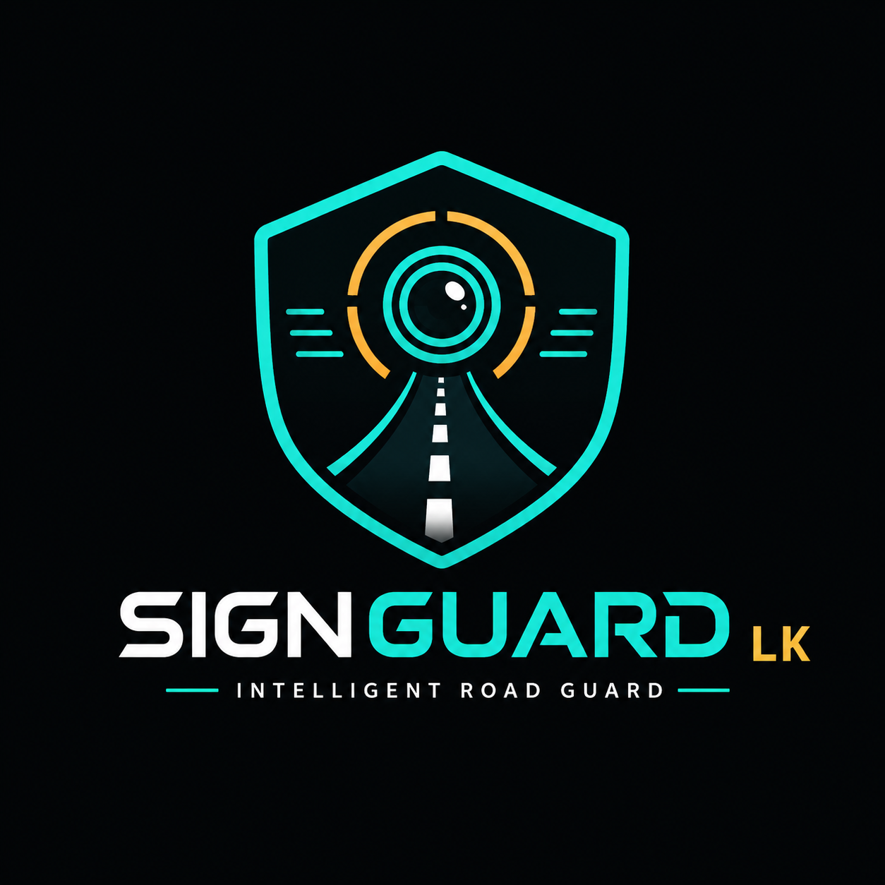

# 🛡️ SignGuard LK

<p align="center">
  
</p>

**Sri Lankan road-sign intelligence for safer driving**

SignGuard LK is a desktop driver-assistance system that detects Sri Lankan traffic signs from a webcam or video file, analyzes driver context such as current speed, and displays real-time visual and voice alerts.

The project combines **YOLOv8**, **OpenCV**, **Tkinter**, and **Text-to-Speech** into a full traffic sign recognition dashboard.

---

## ✨ Key Features

### 🎥 Real-Time Road Vision

- Detect traffic signs from a live webcam
- Scan traffic signs from video files
- Draw detection boxes with class name and confidence
- Show live FPS, confidence, session time, and detection count

### 🧠 Smart Sign Detection

- Uses a trained YOLOv8 model: `best.pt`
- Supports Sri Lankan sign categories:
  - Danger Warning Signs
  - Prohibition Signs
  - Mandatory Signs
  - Speed Limit Signs
  - Traffic Light Signs
  - Other Direction Signs

### 🚦 Driver Assistance Alerts

- Speed limit violation alerts
- School zone warnings
- STOP sign compliance alerts
- Low-confidence/degraded sign warnings
- Color-coded safety states:
  - 🔴 Critical
  - 🟠 Warning
  - 🟢 Safe
  - ⚫ Idle

### 🔊 Voice Alerts

- Text-to-speech driver warnings
- Voice alert toggle
- Throttled speech to avoid repeated alerts

### 🎛️ Runtime Controls

- Confidence threshold control
- IoU threshold control
- Inference image-size control
- Accuracy Mode with test-time augmentation
- Show/hide detection boxes
- Pause/resume stream
- Save road snapshots
- Capture incident snapshots with alert text overlay
- Export SignGuard log as CSV
- Download full HTML session reports
- Download plain text session reports
- Clear detection log

---

## 🖥️ Application Screens

### 🚀 Startup Screen

The startup screen lets you choose:

- **Start Live Guard**: use webcam input
- **Scan Video File**: use a video file
- **Close SignGuard**: exit the application

### 🛡️ Guard Console

The main dashboard includes:

- **Road Vision Feed**: live camera/video display
- **Guard Alert**: current detection alert
- **Drive Telemetry**: speed, GPS, time, FPS
- **Vision Tuning**: confidence, IoU, image size, accuracy mode
- **SignGuard Log**: recent detections
- **Guard Controls**: pause, snapshot, incident capture, report downloads, switch input, stop stream

---

## 🗂️ Project Structure

```text
signguard-lk/
├── app.py
├── best.pt
├── README.md
├── requirements.txt
├── sign.ipynb
└── src/
    ├── main.py
    ├── __init__.py
    ├── config/
    │   ├── __init__.py
    │   └── settings.py
    ├── data/
    │   ├── __init__.py
    │   └── road_signs.py
    ├── services/
    │   ├── __init__.py
    │   ├── detector.py
    │   └── speech.py
    └── ui/
        ├── __init__.py
        ├── components.py
        ├── dashboard.py
        ├── startup.py
        └── theme.py
```

---

## 🧩 File Responsibilities

| File | Purpose |
|---|---|
| `app.py` | Main launcher. Run this file to start the app. |
| `best.pt` | Trained YOLOv8 traffic sign detection model. |
| `requirements.txt` | Python dependencies for running the app. |
| `sign.ipynb` | Training, evaluation, accuracy tuning, and export notebook. |
| `src/main.py` | Application coordinator and Tkinter window setup. |
| `src/config/settings.py` | App name, model path, default thresholds, GPS, speed, and export prefixes. |
| `src/data/road_signs.py` | Sri Lankan traffic sign code-to-name dictionary. |
| `src/services/detector.py` | YOLOv8 inference and traffic-alert decision logic. |
| `src/services/speech.py` | Text-to-speech warning service. |
| `src/ui/theme.py` | Colors and font constants. |
| `src/ui/components.py` | Reusable Tkinter UI components. |
| `src/ui/startup.py` | Branded startup screen. |
| `src/ui/dashboard.py` | Main SignGuard LK dashboard. |

---

## ⚙️ Installation

### 1. Open the Project

```bash
cd signguard-lk
```

### 2. Install Dependencies

```bash
pip install -r requirements.txt
```

### 3. Run the App

```bash
python app.py
```

---

## 📦 Requirements

The app uses:

- Python
- Ultralytics YOLOv8
- OpenCV
- Pillow
- pyttsx3
- Tkinter

`requirements.txt`:

```text
ultralytics
opencv-python
pillow
pyttsx3
```

Tkinter is included with most standard Python installations.

---

## 🧪 Training Notebook

`sign.ipynb` is the full training and evaluation notebook for SignGuard LK.

### Notebook Includes

- Environment setup
- Roboflow dataset download
- Dataset YAML normalization
- Dataset health checks
- Class balance analysis
- YOLOv8 training
- Validation metrics
- Test-set evaluation
- Confidence threshold tuning
- Optional model-size comparison
- Low-confidence error mining
- Training artifact visualization
- ADAS inference simulation
- Exporting `best.pt`
- Packaging report images

### 🔐 Roboflow API Key

Do **not** hardcode your API key in the notebook.

Use one of these:

#### Google Colab Secrets

Create a secret named:

```text
ROBOFLOW_API_KEY
```

#### Local Environment Variable

PowerShell:

```powershell
$env:ROBOFLOW_API_KEY="your_api_key_here"
```

Command Prompt:

```cmd
set ROBOFLOW_API_KEY=your_api_key_here
```

---

## 🎯 Accuracy Improvement Workflow

To improve model accuracy:

1. Open `sign.ipynb`.
2. Set your Roboflow API key securely.
3. Run dataset download and YAML normalization.
4. Check class balance.
5. Train with the provided accuracy-focused settings.
6. Evaluate validation and test metrics.
7. Tune confidence threshold.
8. Review low-confidence/error-mining samples.
9. Add or fix data for weak classes.
10. Retrain and export the new `best.pt`.

Recommended training defaults:

```python
BASE_MODEL = "yolov8m.pt"
IMAGE_SIZE = 768
EPOCHS = 100
```

For faster training:

```python
BASE_MODEL = "yolov8s.pt"
IMAGE_SIZE = 640
EPOCHS = 50
```

For better accuracy:

```python
BASE_MODEL = "yolov8l.pt"
IMAGE_SIZE = 896
EPOCHS = 150
```

---

## 🧠 Runtime Accuracy Controls

| Control | Effect |
|---|---|
| Confidence Threshold | Filters weak predictions. Higher values reduce false positives. |
| IoU Threshold | Controls duplicate box suppression. |
| Inference Image Size | Larger sizes can improve small-sign detection but reduce FPS. |
| Accuracy Mode | Enables test-time augmentation for better detection at lower speed. |
| Show Detection Boxes | Toggles visual boxes on the road feed. |

---

## 📤 Exports

### Road Snapshots

Snapshots are saved with names like:

```text
signguard_lk_snapshot_YYYYMMDD_HHMMSS.jpg
```

### Guard Logs

Detection logs are exported as CSV:

```text
signguard_lk_log_YYYYMMDD_HHMMSS.csv
```

CSV columns:

```text
time,confidence,threat,message
```

### Session Reports

Full reports can be downloaded as:

```text
signguard_lk_report_YYYYMMDD_HHMMSS.html
signguard_lk_report_YYYYMMDD_HHMMSS.txt
```

Reports include:

- session source
- start/end time
- duration
- total detections
- critical/warning/safe counts
- average confidence
- top detected signs
- runtime detection settings
- full detection event table

### Incident Snapshots

Incident snapshots are saved with alert text embedded into the image:

```text
signguard_lk_incident_YYYYMMDD_HHMMSS.jpg
```

---

## 🧹 Git Ignore

The project includes `.gitignore` for:

- Python cache files
- virtual environments
- `.env` files
- Jupyter checkpoints
- YOLO training outputs
- exported snapshots/logs
- OS/editor files
- logs

---

## 🛠️ Troubleshooting

### Webcam Does Not Open

- Make sure another app is not using the camera.
- Try restarting the app.
- Use **Scan Video File** if no webcam is available.

### `ultralytics` Not Found

```bash
pip install ultralytics
```

Or reinstall all dependencies:

```bash
pip install -r requirements.txt
```

### Voice Alerts Do Not Work

```bash
pip install pyttsx3
```

On Windows, make sure system speech voices are installed.

### Model File Missing

The app expects this file in the project root:

```text
best.pt
```

Export it from `sign.ipynb` or copy your trained YOLO model into the root folder.

### Low FPS

Try:

- Disable Accuracy Mode
- Reduce inference image size
- Use `yolov8s.pt` during training
- Close other heavy applications

### Too Many False Positives

Try:

- Increase confidence threshold
- Tune IoU threshold
- Improve dataset labels
- Add more examples for confusing sign classes

---

## 🚀 Quick Start

```bash
pip install -r requirements.txt
python app.py
```

---

## 📌 Project Name Meaning

**SignGuard LK**

- **Sign**: traffic sign detection
- **Guard**: driver safety assistance
- **LK**: Sri Lanka focus
